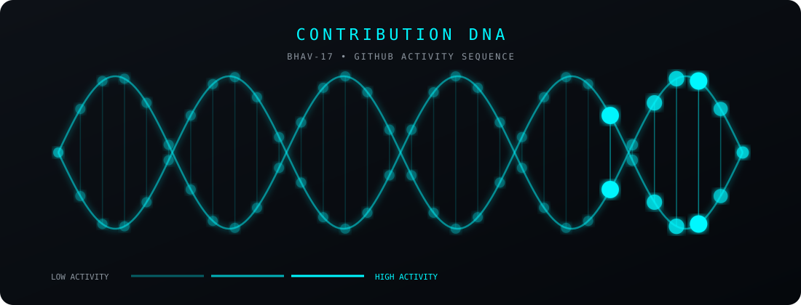

<div align="center">


<br>


<br><br>

<a href="https://github.com/bhav-17">

</a>
<a href="https://www.linkedin.com/in/bhavya-prakash17/">

</a>
<a href="mailto:prakashbhavya.1720@gmail.com">

</a>

<br><br>


</div>


<br>

# `01` — WHO AM I?

<table>
<tr>

<td width="55%" valign="top">

### 👋 A LITTLE ABOUT ME

I'm a **Computer Science student** turning curiosity into code and ideas into projects.

<br>

🧑‍💻 **Developer in progress**  
🎨 **UI/UX enthusiast**  
💡 **Curious problem solver**  
🚀 **Building skills, projects & experience**

<br>

### 💭 MY APPROACH

```text
LEARN → BUILD → BREAK → DEBUG → SHIP
```

</td>

<td width="45%" valign="top">

### 🎯 CURRENT FOCUS

| | |
|---|---|
| 💻 **Building** | Web development projects |
| 🎨 **Exploring** | UI/UX & frontend design |
| 🐍 **Working with** | C++ & Python |
| 🚀 **Growing through** | Projects & real-world experience |

</td>

</tr>
</table>

<br>

<div align="center">

> ### **I don't just want to write code.**
> ### **I want to turn ideas into things people can actually use.**

</div>

---

# `02` — TECH ARSENAL

<div align="center">

### LANGUAGES


<br><br>

### TOOLS & TECHNOLOGIES


<br><br>
</div>

---

# `03` — FEATURED WORK

<div align="center">

> ### Projects I'm building and experimenting with.

</div>

<!--
  HOW TO ADD A PROJECT: replace one "coming soon" card below with a real one, e.g.

  <a href="https://github.com/bhav-17/YOUR-REPO">
    
  </a>
-->

<table>
<tr>

<td width="33%" valign="top" align="center">

### 🚧 PROJECT 01
**Coming soon**

<sub>`HTML` · `CSS` · `JS`</sub>

<sub>A web project in progress.</sub>

</td>

<td width="33%" valign="top" align="center">

### 🚧 PROJECT 02
**Coming soon**

<sub>`C++` · `Python`</sub>

<sub>Experiments in problem solving.</sub>

</td>

<td width="33%" valign="top" align="center">

### 🚧 PROJECT 03
**Coming soon**

<sub>`UI/UX` · `Figma`</sub>

<sub>A design-meets-code build.</sub>

</td>

</tr>
</table>

<div align="center">

```text
Currently building and refining. The best work will appear here.
```

<a href="https://github.com/bhav-17?tab=repositories">

</a>

</div>

---

# `04` — GITHUB ACTIVITY

<div align="center">



</div>

---

# `05` — GITHUB STATS

<div align="center">


<br><br>


<br><br>


<br><br>

</div>

---

# `06` — GITHUB BADGES

<div align="center">


</div>

---

# `06` — CONTRIBUTION DNA

<p align="center">
  
</p>

---

# `07` — THE PROCESS

<div align="center">

```text
 ┌──────┐   ┌──────────┐   ┌────────┐   ┌───────┐
 │ IDEA │ → │ RESEARCH │ → │ DESIGN │ → │ BUILD │
 └──────┘   └──────────┘   └────────┘   └───┬───┘
                                            ↓
 ┌──────┐   ┌───────┐   ┌───────┐   ┌───────────┐
 │ SHIP │ ← │ DEBUG │ ← │ TEST  │ ← │  ITERATE  │
 └──────┘   └───────┘   └───────┘   └───────────┘
```

> `Progress > perfection.`

</div>

---

# `08` — TERMINAL

```bash
┌──(bhavya㉿github)-[~/life]
└─$ ./build_future.sh

[+] Initializing...
[+] Learning...
[+] Building...
[+] Experimenting...
[+] Debugging...
[+] Improving...
[+] Shipping...

████████████████████████████████ 100%

✓ Future successfully compiled.
```

---

# `09` — CONNECT

<div align="center">

### 📩 LET'S BUILD SOMETHING

Open to collaborations, learning opportunities and interesting ideas.

<br>

<table>
<tr>
<td align="center"><b>📧 Mail</b></td>
<td><a href="mailto:prakashbhavya.1720@gmail.com">prakashbhavya.1720@gmail.com</a></td>
</tr>
<tr>
<td align="center"><b>🐙 GitHub</b></td>
<td><a href="https://github.com/bhav-17">bhav-17</a></td>
</tr>
<tr>
<td align="center"><b>💼 LinkedIn</b></td>
<td><a href="https://www.linkedin.com/in/bhavya-prakash17/">bhavya-prakash17</a></td>
</tr>
</table>

<br>
</div>


